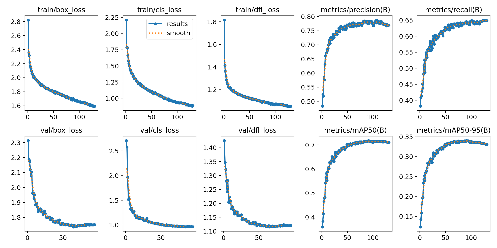
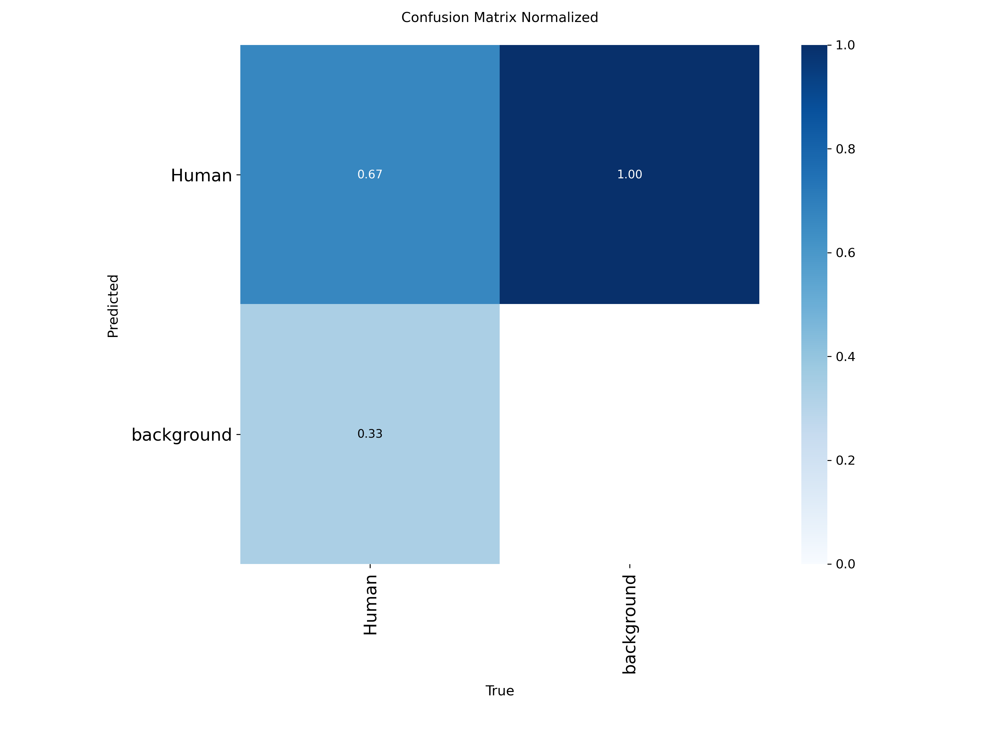

# VisDrone Human Detection with YOLO11m-P2

This graduation thesis project adds a P2 detection head to YOLO11m to detect small people in drone imagery. The notebook demonstrates converting VisDrone-DET2019 annotations into a single human class, training and validating the model, and tracking detections in video with ByteTrack.

**Türkçe:** [README.tr.md](README.tr.md) · **English notebook:** [visdrone-yolo11m-p2.en.ipynb](notebooks/visdrone-yolo11m-p2.en.ipynb) · **Türkçe notebook:** [visdrone-yolo11m-p2.ipynb](notebooks/visdrone-yolo11m-p2.ipynb)

## Notebook and reproduction

Open the [English notebook](notebooks/visdrone-yolo11m-p2.en.ipynb) to read the project as a presentation. It targets Google Colab and includes GPU and Google Drive setup steps. The personal Colab link and saved cell outputs have been removed. Model and dataset configurations are also provided under [`models/`](models/) and [`data/`](data/).

A Colab GPU runtime is recommended. The notebook attempts to download VisDrone; access and usage terms remain subject to the dataset provider's conditions.

## Validation results

These metrics were printed when `best.pt` was separately evaluated on 548 validation images and saved in [`results/val_results.json`](results/val_results.json):

| Metric | Value |
| --- | ---: |
| Precision | 0.7642 |
| Recall | 0.6207 |
| mAP@50 | 0.6910 |
| mAP@50–95 | 0.3278 |

These are validation metrics, not test-set results. The training log and per-epoch metrics are omitted from this presentation draft.

## Repository contents

- `notebooks/`: English and Turkish Colab notebooks
- `models/yolo11m-p2.yaml`: P2–P5 model architecture
- `data/visdrone-human.yaml`: single-class dataset configuration
- `results/`: validation JSON and plots

The dataset, model weights, training sample images, and video files are not included. Use the notebook's training steps to produce weights locally.

## Licensing

The source code is licensed under **AGPL-3.0-only**. The full license is in [`LICENSE`](LICENSE); third-party terms and notices are in [`THIRD_PARTY_NOTICES.md`](THIRD_PARTY_NOTICES.md).

The VisDrone-DET2019 dataset is not included, and this code license does not grant rights to the dataset. [Ultralytics' VisDrone documentation](https://docs.ultralytics.com/tr/datasets/detect/visdrone) documents the dataset source and download/conversion process, but labels its license field “No license.” [Dataset Ninja](https://datasetninja.com/vis-drone-2019-det) calls the dataset publicly available, while its disclaimer says it claims no rights and places license checks on the user. Neither page grants redistribution rights. The official 2019 repository README also does not specify a license; confirm the terms for this release with the dataset provider. Do not assume VisDrone2021 terms apply to VisDrone2019.

## Citation

Please cite the VisDrone-DET2019 paper:

> Zhu, Pengfei, et al. “Detection and Tracking Meet Drones Challenge.” *IEEE Transactions on Pattern Analysis and Machine Intelligence*, vol. 44, no. 11, 2022, pp. 7380–7399. DOI: [10.1109/TPAMI.2021.3119563](https://doi.org/10.1109/TPAMI.2021.3119563).

Citation does not replace permission to use or redistribute the dataset.
