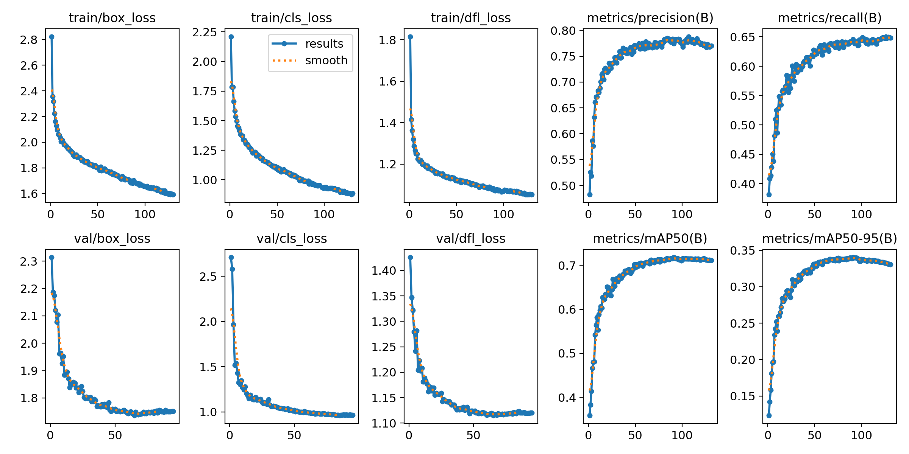
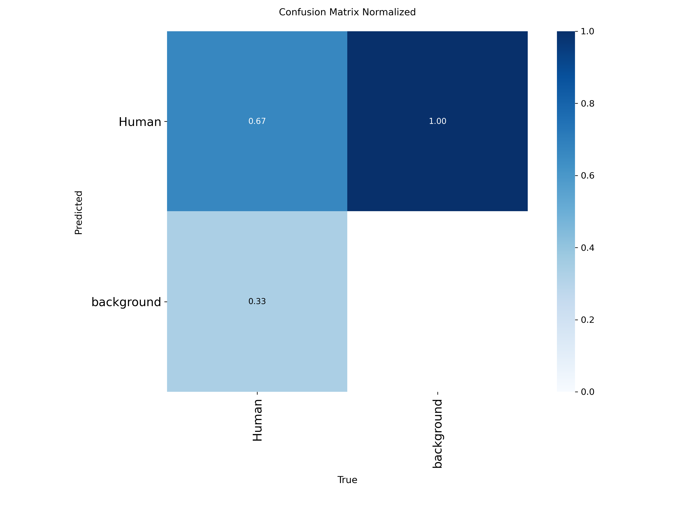

> English version: [README.md](README.md) · [English notebook](notebooks/visdrone-yolo11m-p2.en.ipynb)

# VisDrone İnsan Tespiti — YOLO11m-P2

Bu mezuniyet tezi projesi, drone görüntülerinde küçük insan/yaya nesnelerini tespit etmek için YOLO11m modeline P2 algılama başlığı ekler. Notebook, VisDrone-DET2019 verisini insan sınıfına dönüştürme, modeli eğitme, doğrulama ve ByteTrack ile video üzerinde izleme akışını sunar.

## Sunum ve tekrar üretim

GitHub’da notebook’u sunum gibi okumak için [`notebooks/visdrone-yolo11m-p2.ipynb`](notebooks/visdrone-yolo11m-p2.ipynb) dosyasını açın. Notebook Colab odaklıdır; GPU ve Google Drive kurulum adımları içerir. Kişisel Colab bağlantısı ve kayıtlı hücre çıktıları temizlenmiştir. Proje yapılandırmaları ayrıca [`models/`](models/) ve [`data/`](data/) altındadır.

Notebook en iyi deneyim için Colab GPU oturumu gerektirir. Veri kümesi otomatik olarak indirilmeye çalışılır; erişim ve veri kullanım koşulları veri sağlayıcısına bağlıdır.

## Son doğrulama sonuçları

`results/val_results.json` dosyasındaki `best.pt` doğrulama ölçümleri (548 doğrulama görüntüsü):

| Metrik | Değer |
| --- | ---: |
| Precision | 0.7642 |
| Recall | 0.6207 |
| mAP@50 | 0.6910 |
| mAP@50–95 | 0.3278 |

Bunlar test kümesi sonucu değildir. Eğitim günlüğü ve ara epoch metrikleri bu sunum taslağında yer almaz.

## Depo içeriği

- `notebooks/`: açıklamalı Colab notebook’u
- `models/yolo11m-p2.yaml`: P2–P5 model mimarisi
- `data/visdrone-human.yaml`: tek sınıflı veri kümesi ayarı
- `results/`: doğrulama JSON’u ve grafikler

Model ağırlıkları, veri kümesi, eğitim örnek görselleri ve video dosyaları depoya eklenmemiştir. Büyük ağırlıkları Git’e koymak yerine notebook’taki eğitim adımlarını kullanın.

## Lisanslar

Bu depodaki kaynak kod için **AGPL-3.0-only** işaretlemesi kullandım; gerekçesi ve üçüncü taraf bildirimleri [`THIRD_PARTY_NOTICES.md`](THIRD_PARTY_NOTICES.md) dosyasında. Tam metin için [`LICENSE`](LICENSE) içindeki GNU bağlantısına bakın.

VisDrone-DET2019 veri kümesi depoda değildir ve bu kod lisansı veri kümesine izin vermez. [Ultralytics’in VisDrone veri kümesi dokümanı](https://docs.ultralytics.com/tr/datasets/detect/visdrone) VisDrone2019-DET kaynağını ve indirme/dönüştürme akışını belgeliyor; sayfada lisans alanı “No license” olarak işaretlenmiş. [Dataset Ninja](https://datasetninja.com/vis-drone-2019-det) “publicly available” dese de kendi uyarısında hak iddiasında bulunmadığını ve kullanım izinlerini asıl kaynaktan kontrol etmenin kullanıcı sorumluluğunda olduğunu söylüyor. Bu nedenle bu sayfalar yeniden dağıtım lisansı sağlamıyor. Resmi 2019 deposunda da README düzeyinde lisans belirtilmediğinden, veri sağlayıcısından 2019 sürümü için geçerli şartları teyit edin. VisDrone2021 için yayımlanmış koşulları 2019 sürümüne otomatik olarak uygulamayın.

## Atıf

VisDrone-DET2019 için şu çalışmaya atıf verin:

> Zhu, Pengfei, et al. “Detection and Tracking Meet Drones Challenge.” *IEEE Transactions on Pattern Analysis and Machine Intelligence*, vol. 44, no. 11, 2022, pp. 7380–7399. DOI: [10.1109/TPAMI.2021.3119563](https://doi.org/10.1109/TPAMI.2021.3119563).

Atıf, veri kümesini kullanma veya yeniden dağıtma izni yerine geçmez.
